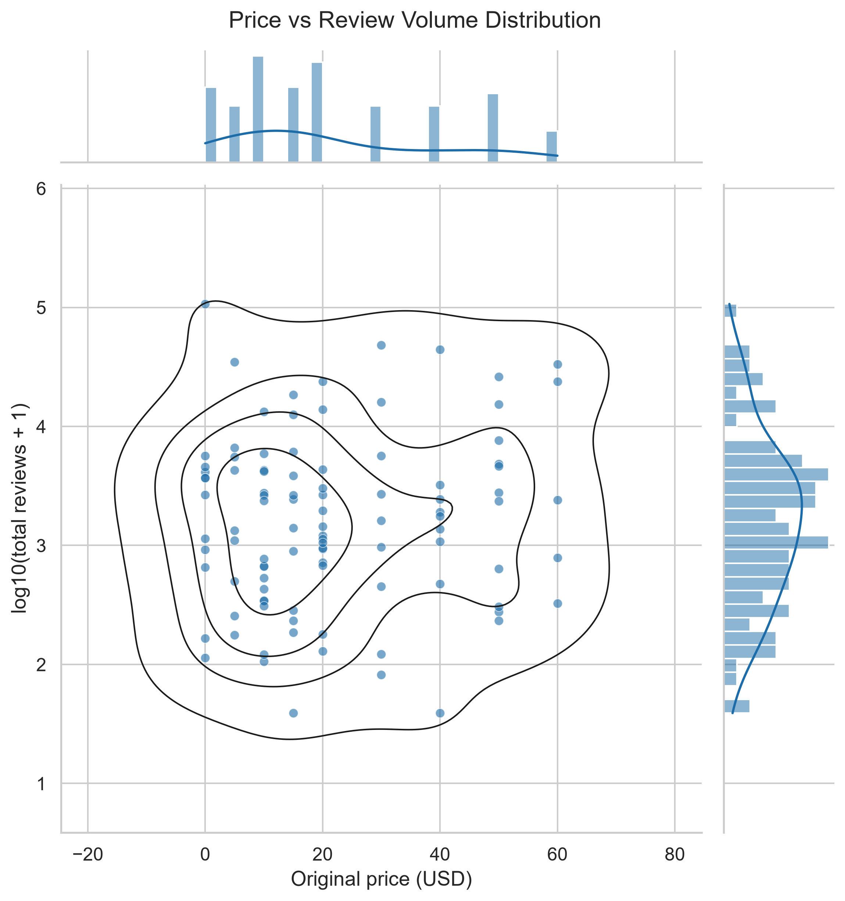
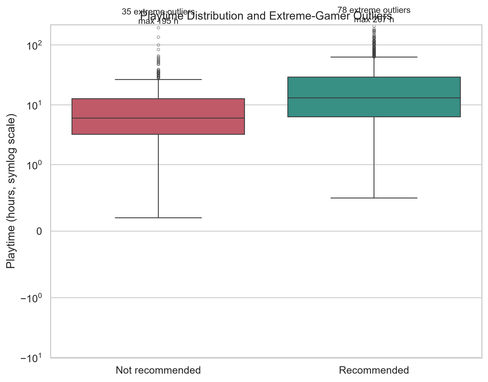
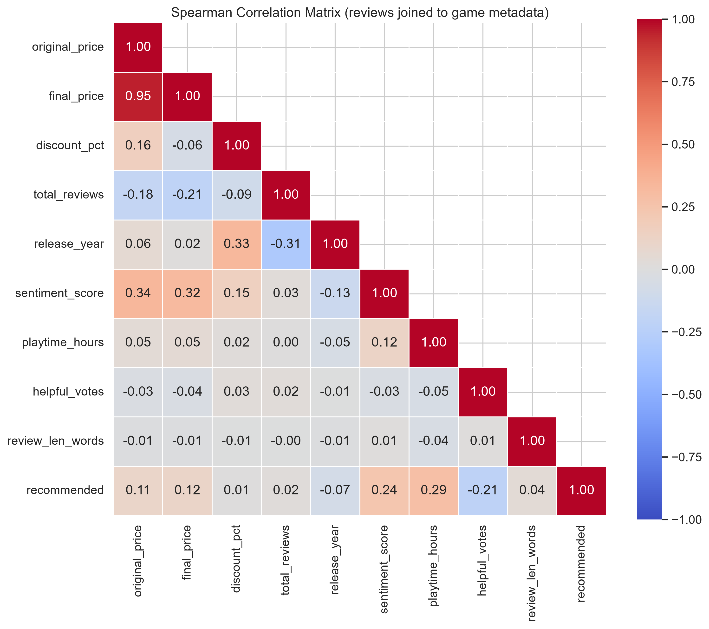
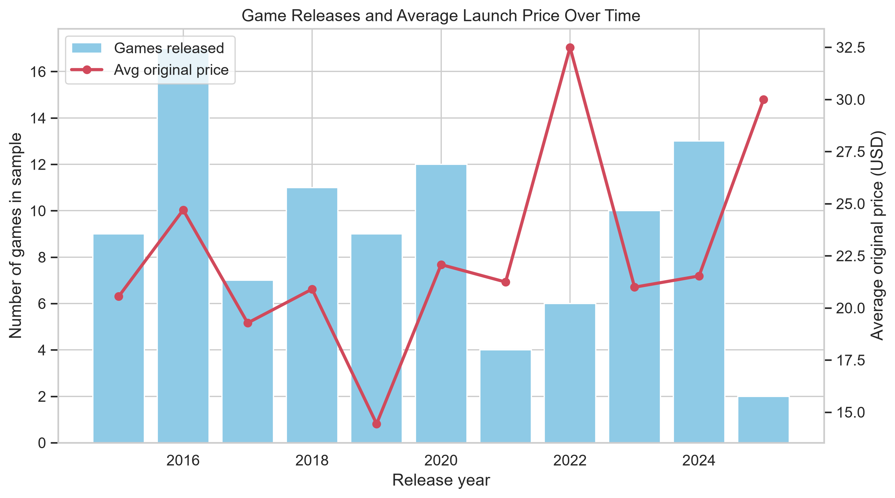
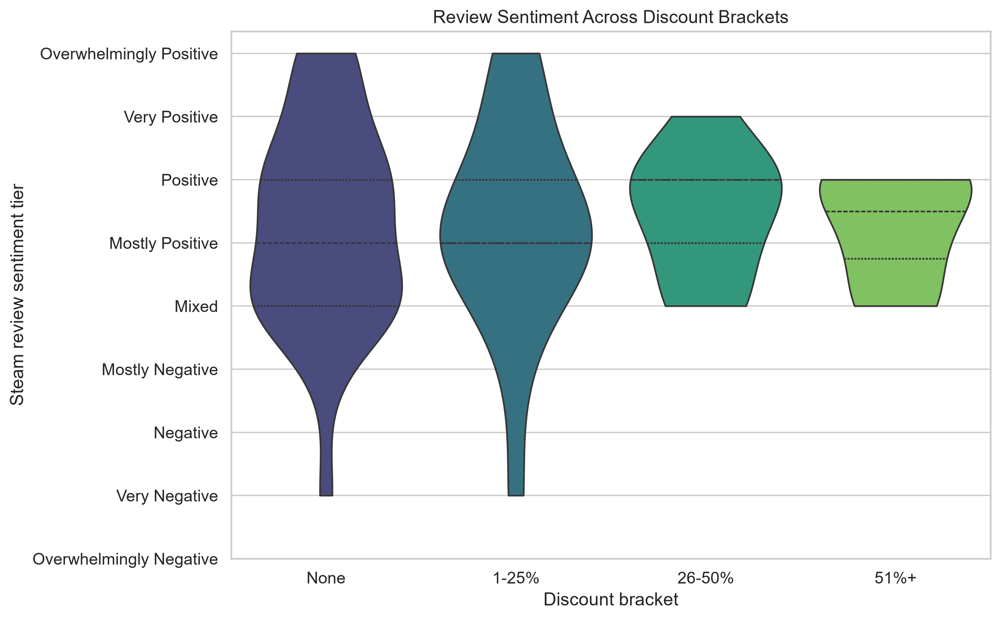

# CodeAlpha_ExploratoryDataAnalysis

Exploratory Data Analysis for the **CodeAlpha Data Analytics Internship (Task 2)**, built on the Steam datasets scraped in Task 1 (`CodeAlpha_WebScraping`).

## Business Questions
1. **Visibility:** Do discounted games attract significantly more user reviews than full-price games?
2. **Engagement:** Is longer playtime associated with a review being positive (recommended)?
3. **Pricing vs. quality:** Is price tier (Free, Budget, Mid-tier, AAA) independent of Steam's review summary?
4. **Market trends:** How have release volume and average launch price changed over time?
5. **Discount strategy:** Does review sentiment differ across discount depth brackets?

## Methodology
- **Cleaning:** dedup by `app_id` / `review_id`, numeric coercion, missing-value imputation (prices from each other, discount to 0, playtime to median), date parsing into `release_year` / `release_month`, review length features, `price_tier` (Free = $0, Budget < $10, Mid-tier $10-$30, AAA >= $30).
- **Outliers:** IQR method (1.5 x IQR fences) on `original_price` and `playtime_hours`. Outliers are flagged, not removed, so no information is lost.
- **Tests:** Mann-Whitney U (review counts are heavy-tailed, checked with Shapiro-Wilk), Spearman correlation with point-biserial as a robustness check, and Chi-square with Cramer's V. Significance level alpha = 0.05.
- **Sentiment scale:** Steam labels mapped to an ordinal 0-8 score (Overwhelmingly Negative to Overwhelmingly Positive).

## Hypothesis Test Summary
Run the pipeline, then paste the table from `reports/results_summary.md` here.

| Test | Question | H0 | Statistic | p-value | Conclusion |
|---|---|---|---|---|---|
| Mann-Whitney U | Q1 | Discounted games do not have more reviews | see report | see report | see report |
| Spearman / point-biserial | Q2 | No association between playtime and recommendation | see report | see report | see report |
| Chi-square | Q3 | Price tier and review summary are independent | see report | see report | see report |

## Anomaly Detection Insights
Paste the "Anomaly detection" section from `reports/results_summary.md` here. Typical patterns to discuss: a long right tail in review counts, a small share of AAA-priced titles, and a few reviewers with playtime far beyond the upper IQR fence who can distort mean-based statistics.

## Visualizations






## Setup and Usage
```bash
git clone https://github.com/<your-username>/CodeAlpha_ExploratoryDataAnalysis.git
cd CodeAlpha_ExploratoryDataAnalysis
python -m venv .venv && source .venv/bin/activate   # Windows: .venv\Scripts\activate
pip install -r requirements.txt
# place steam_games_metadata.csv and steam_user_reviews.csv in data/
python src/eda_pipeline.py
```

## Limitations
- If the input data came from the synthetic fallback in Task 1, findings describe simulated data, not the real Steam market.
- Top-seller sampling biases results toward successful games.
- Correlation does not imply causation.